> 📁 **最新项目路径**: `example/XEMOWO_TEST20_MX`

<h1 align="center">
  🏠 XEMOWO emMCP-Home
</h1>

<div align="center">

**基于 STM32 + emMCP 的 AI 智能家居控制终端**

[](https://www.st.com/en/microcontrollers-microprocessors/stm32f103.html)
[](https://www.freertos.org/)
[](https://github.com/Ai-Thinker-Open/emMCP)
[](https://github.com/Ai-Thinker-Open/emMCP/blob/master/LICENSE)
[](https://cmake.org/)

</div>

<br>

> 📢 **一句话介绍**：通过 AI 语音/文本对话，自然地控制空调、灯带、继电器等红外和有线外设。MCU 通过 **MCP 协议（Model Context Protocol）** 将硬件外设注册为 AI 可调用的工具，实现"说句话就控制家电"。

<div align="center">
  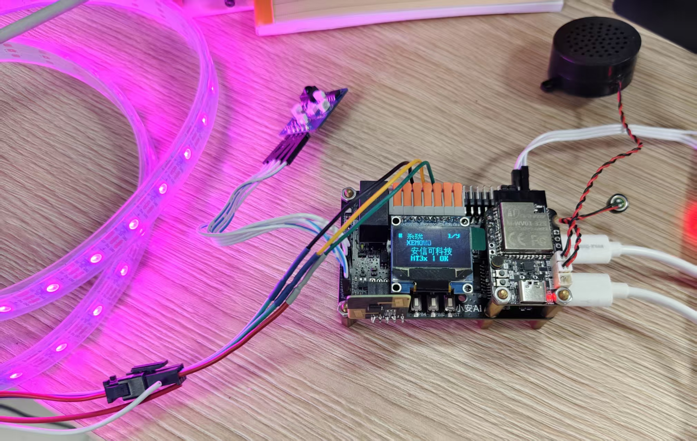
  <br><sub>▲ emMCP-Home 硬件实物</sub>
</div>

---

## 🛠 硬件平台

本项目基于安信可 **[九章验证板 (9Mod-MCPBoard)](https://docs.ai-thinker.com/9mod-mcpboard/)** 开发。

> 九章验证板是安信可推出的 **Ai-MCU 开源验证平台**，搭载 STM32F103CBTx 主控，板载 SHT30 温湿度传感器、WS2812B 灯带接口、SSD1306 OLED 接口、红外收发等外设，原生支持 emMCP 框架，是 AI+MCU 快速原型验证的理想选择。

📖 [九章验证板官方文档](https://docs.ai-thinker.com/9mod-mcpboard/)

---

## 📑 目录

- [🛠 硬件平台](#-硬件平台)
- [✨ 核心特性](#-核心特性)
- [🛠 硬件清单](#-硬件清单)
- [🔌 引脚连接](#-引脚连接)
- [🏗 软件架构](#-软件架构)
- [🎮 OLED 界面](#-oled-界面)
- [🤖 MCP 工具](#-mcp-工具)
- [📂 项目结构](#-项目结构)
- [🚀 快速开始](#-快速开始)
- [📸 效果展示](#-效果展示)
- [🙏 致谢](#-致谢)

---

## ✨ 核心特性

<table>
<tr>
<td width="50%">

### 🤖 AI 语音控制
- 通过 **Ai-Thinker UART-MCP 协议** 与 AI 模组通信
- 注册 **7 个 MCP 工具**：继电器、空调温度/模式/电源/风速、灯带、串口状态监控
- 支持自然语言交互（"把空调调到 26 度制冷模式"）

### 🌡 环境感知
- **SHT3x** 高精度温湿度传感器 (±0.2°C, ±2%RH)
- 实时 OLED 显示温度/湿度数值
- 传感器状态自动检测

</td>
<td width="50%">

### 📡 智能联动
- **Rd-03L_V2 毫米波雷达**：人体存在检测
- 人走自动关灯，人来恢复彩虹呼吸灯效
- 可配置的无人检测阈值 (~5 秒)

### 🎨 炫彩灯光
- **WS2812B** 可寻址 RGB LED 灯带 (最多 60 颗)
- 彩虹色相循环 + 呼吸亮度效果
- HSV 色彩空间转换，过渡更自然
- 支持远程调色、开关、亮度控制

</td>
</tr>
<tr>
<td width="50%">

### 🖥 9 页 OLED 交互
- **SSD1306 128x64 OLED** 显示屏
- 9 个页面：系统信息 / 温度 / 湿度 / 任务监控 / UART 数据 / AI 状态 / 猫咪动画 / MCP 工具 / 红外学习
- 双按键翻页，数据自动滚动

### 🔴 红外万能遥控
- **HXD039B2** 红外串口模块
- 支持红外码学习（一键学习任意遥控器）
- 控制空调：开关、温度 (16-31°C)、模式 (自动/制冷/除湿/送风/制热)

</td>
<td width="50%">

### 🔧 工程品质
- **FreeRTOS** 多任务实时调度
- **CMake + Ninja** 现代化构建系统
- **GT20L16S** 中文字库芯片，完美支持中文显示
- **OpenOCD** + ST-Link 调试
- 模块化驱动架构，易于移植

</td>
</tr>
</table>

---

## 🛠 硬件清单

| 序号 | 模块 | 型号 | 接口 | 功能 |
|:---:|------|------|------|------|
| 1 | **主控** | STM32F103CBTx | — | ARM Cortex-M3, 128KB Flash, 20KB RAM |
| 2 | **AI 模组** | AiPi-PalChatV1 | UART2 @ 115200 | AI 语音交互 + MCP 协议通信 |
| 3 | **OLED 屏** | SSD1306 128×64 | SPI1 | 9 页信息显示 + 猫咪动画 |
| 4 | **字库芯片** | GT20L16S | SPI1 (共享) | GB2312 中文字库 ROM |
| 5 | **温湿度** | SHT30-DIS | I²C (软) | ±0.2°C 温度, ±2%RH 湿度 |
| 6 | **灯带** | WS2812B ×60 | TIM1 CH4 PWM+DMA | 可寻址 RGB LED |
| 7 | **红外模块** | HXD039B2-MML | UART3 @ 57600 | 红外学习 + 空调控制 |
| 8 | **毫米波雷达** | Rd-03L_V2 | GPIO PA8 | 24GHz 人体存在检测 |
| 9 | **继电器** | SRD-05VDC | GPIO PB5 | 开关量输出 |
| 10 | **按键** | 轻触开关 ×2 | GPIO PB4, PB8 | OLED 翻页控制 |
| 11 | **调试器** | ST-Link V2 | SWD | 烧录 + 调试 |

---

## 🔌 引脚连接

```

                      STM32F103CBTx                            
                                                              
  SPI1 ──────┬── MOSI (PA7)  ─── SSD1306 OLED (DIN)          
             ├── SCK  (PA5)  ─── SSD1306 OLED (CLK)          
             ├── CS1  (PA4)  ─── SSD1306 OLED (CS)            
             └── CS2  (PA3)  ─── GT20L16S 字库 (CS)           
                                                               
  USART1 ─── TX (PA9) / RX (PA10) ─── 调试串口 (115200)       
  USART2 ─── TX (PA2) / RX (PA3) ─── AI 模组 UART-MCP         
  USART3 ─── TX (PB10)/ RX (PB11)── HXD039B2 红外模块 (57600) 
                                                               
  I²C (软) ── SDA (PB6) / SCL (PB7) ─── SHT3x               
                                                               
  PWM+DMA ── TIM1 CH4 (PA11) ──── WS2812B 灯带 DIN            
                                                               
  GPIO ────┬── PA8  ─── Rd-03L_V2 雷达 OT1 (人体存在)         
           ├── PB5  ─── 继电器控制                             
           ├── PB4  ─── 按键 UP (上翻页)                       
           ├── PB8  ─── 按键 DOWN (下翻页)                     
           └── PB1  ─── HXD039B2 BUSY (红外忙检测)             
                                                               
  SWD ─────── SWDIO / SWCLK ─── ST-Link V2 调试器              

```

---

## 🏗 软件架构

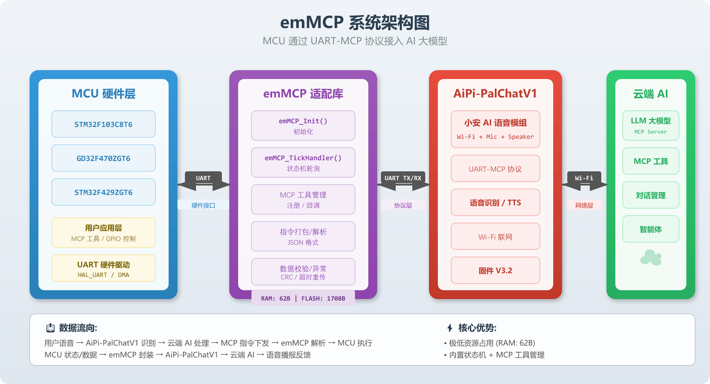

---

## 🎮 OLED 界面

9 页信息显示，双按键 (UP/DOWN) 翻页：

| 页码 | 标题 | 内容 |
|:---:|------|------|
| **1/9** | 🖥 系统 | 项目名 / 作者 / 公司 / SHT3x 状态 |
| **2/9** | 🌡 温度 | 实时温度数值 (精度 0.1°C) |
| **3/9** | 💧 湿度 | 实时湿度数值 (精度 0.1%) |
| **4/9** | 📊 任务监控 | FreeRTOS 任务名 / 状态 / 优先级 / 栈余量 (自动轮播) |
| **5/9** | 📡 UART 数据 | AI 模组串口原始数据实时滚动显示 |
| **6/9** | 🤖 AI 模块 | AI 事件状态 / WiFi 连接状态 / MCP 文本滚动 |
| **7/9** | 🐱 猫咪动画 | 28 帧像素猫咪动画 (可选启用，~28KB Flash) |
| **8/9** | 🔧 MCP 工具 | 已注册工具列表 + 描述 (自动轮播) |
| **9/9** | 📡 红外学习 | 学习状态 / 码组显示 / 按键触发学习 |

> 💡 **交互提示**：进入第 9 页自动开始红外学习；进入第 8 页自动触发红外学习复位。

### 📸 OLED 实拍

<table>
<tr align="center">
<td width="33%"><b>屏幕 1 — 系统信息</b></td>
<td width="33%"><b>屏幕 2 — 温度</b></td>
<td width="33%"><b>屏幕 3 — 湿度</b></td>
</tr>
<tr align="center">
<td>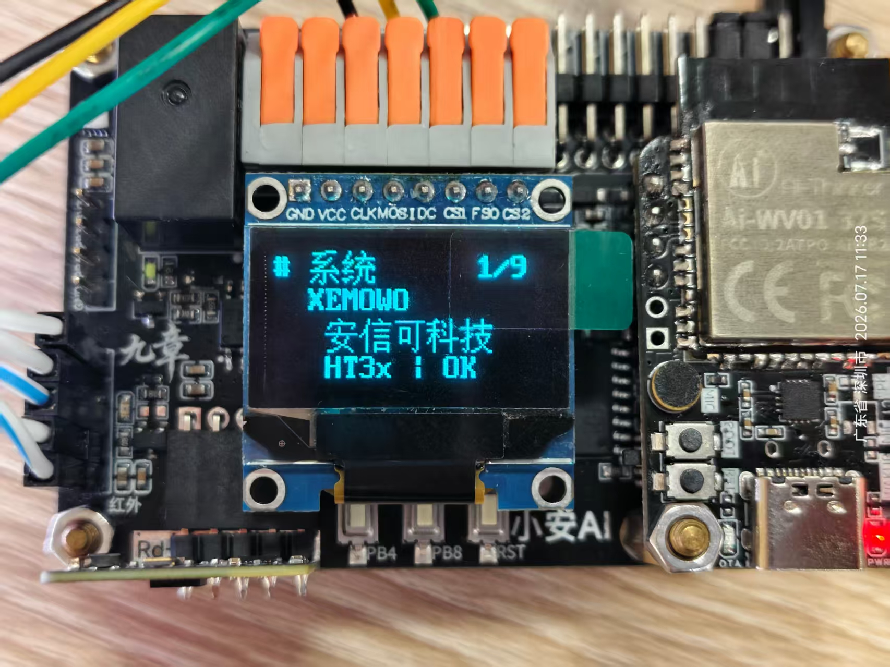</td>
<td>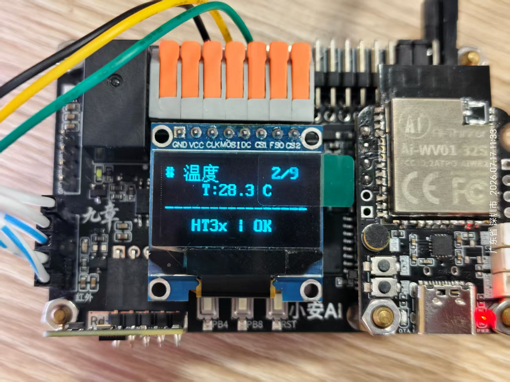</td>
<td>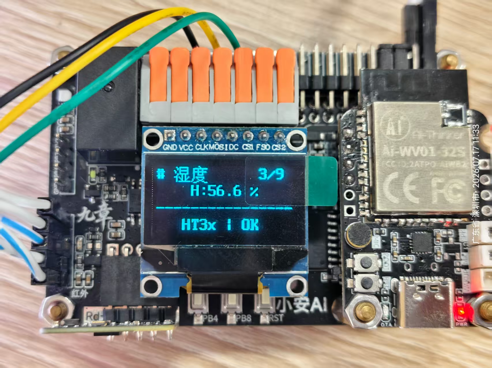</td>
</tr>
<tr><td colspan="3"><br></td></tr>
<tr align="center">
<td><b>屏幕 4 — 任务监控</b></td>
<td><b>屏幕 5 — UART 数据</b></td>
<td><b>屏幕 6 — AI 模块</b></td>
</tr>
<tr align="center">
<td>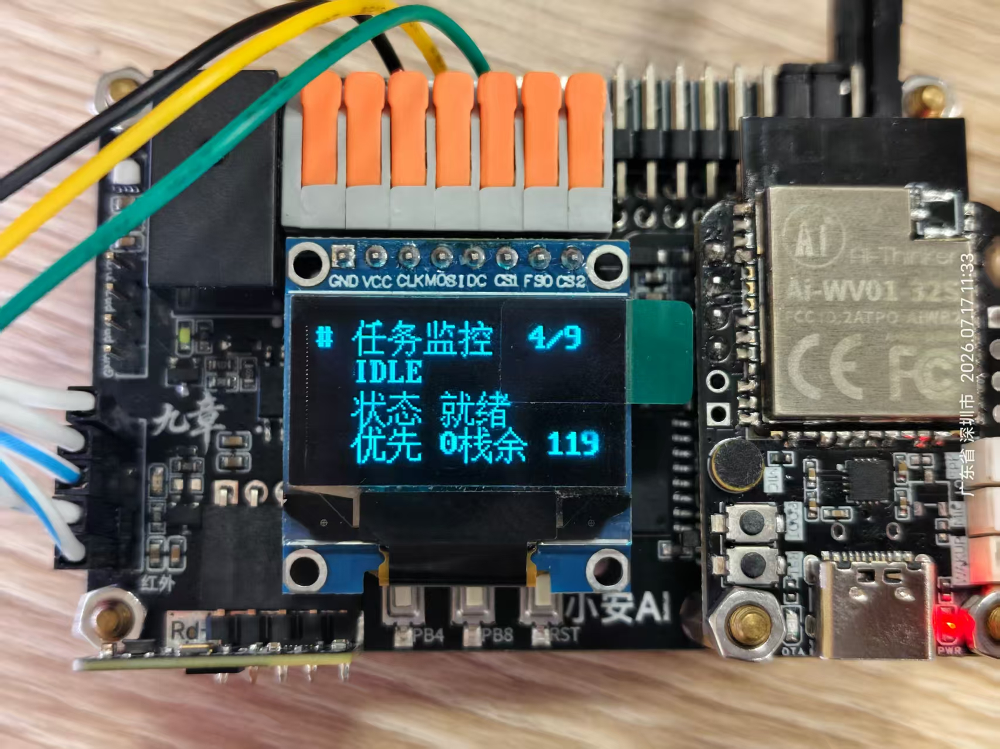</td>
<td>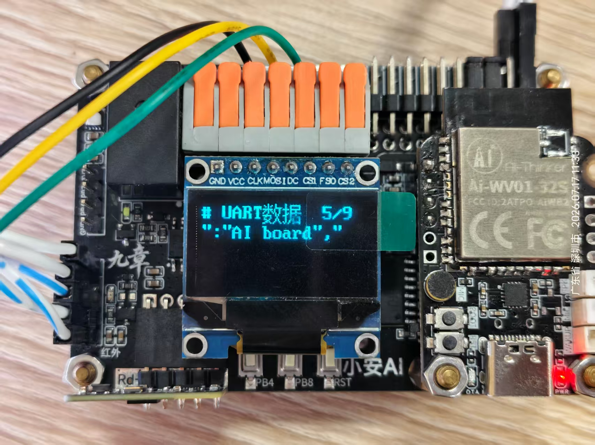</td>
<td>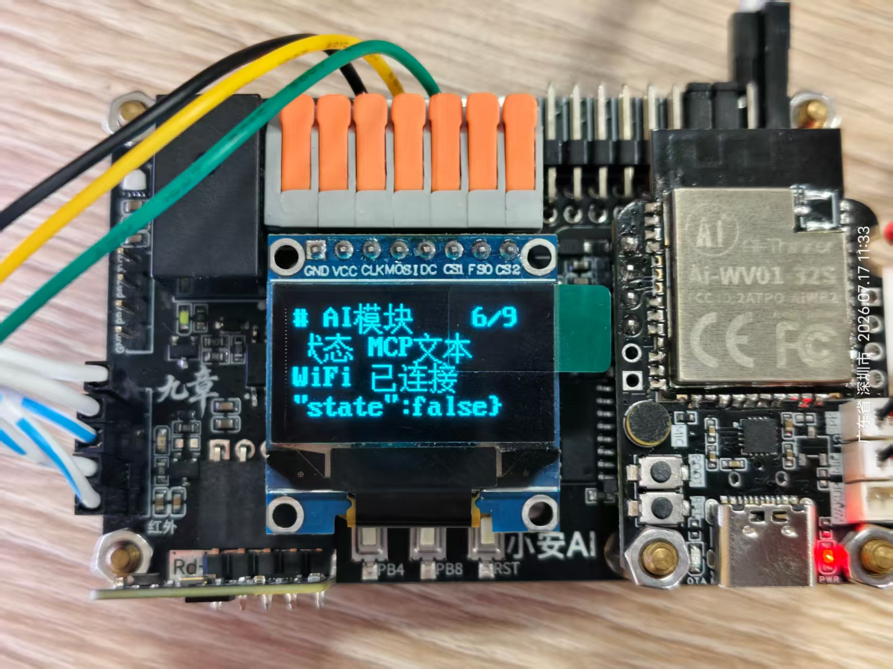</td>
</tr>
<tr><td colspan="3"><br></td></tr>
<tr align="center">
<td><b>屏幕 7 — 猫咪动画</b></td>
<td><b>屏幕 8 — MCP 工具</b></td>
<td><b>屏幕 9 — 红外学习</b></td>
</tr>
<tr align="center">
<td>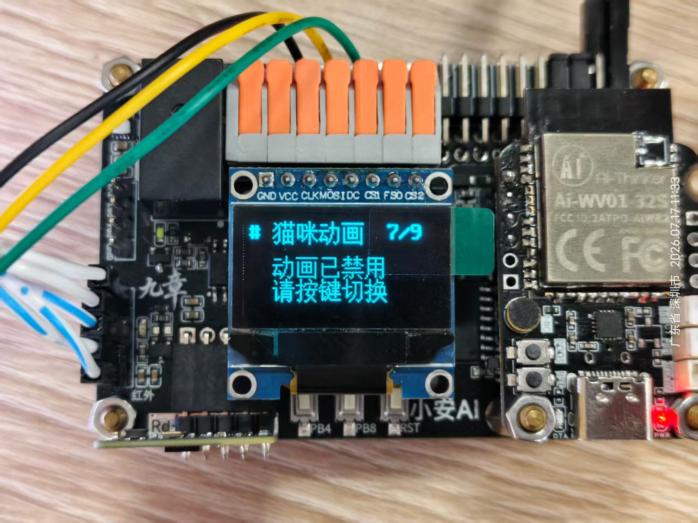</td>
<td>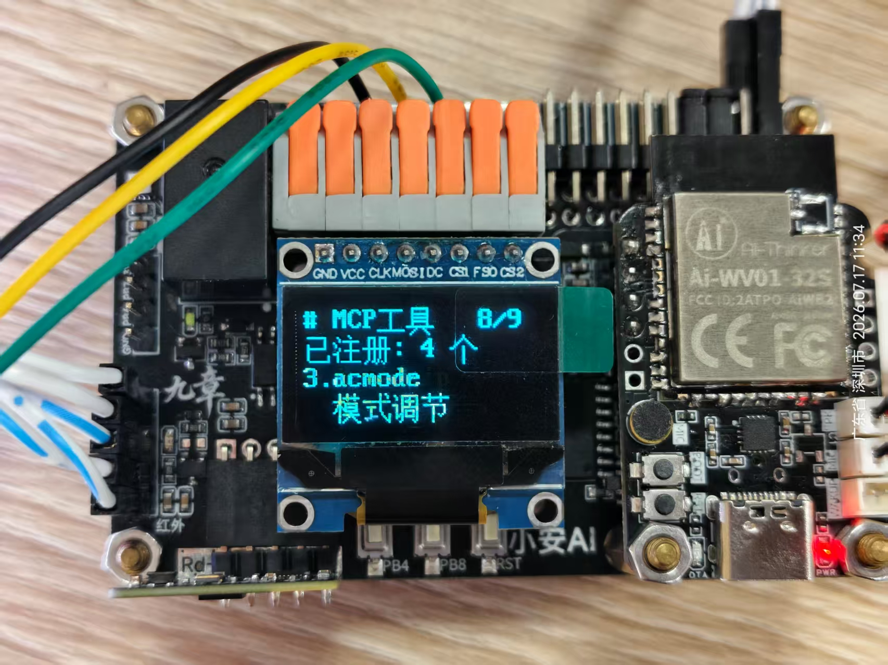</td>
<td>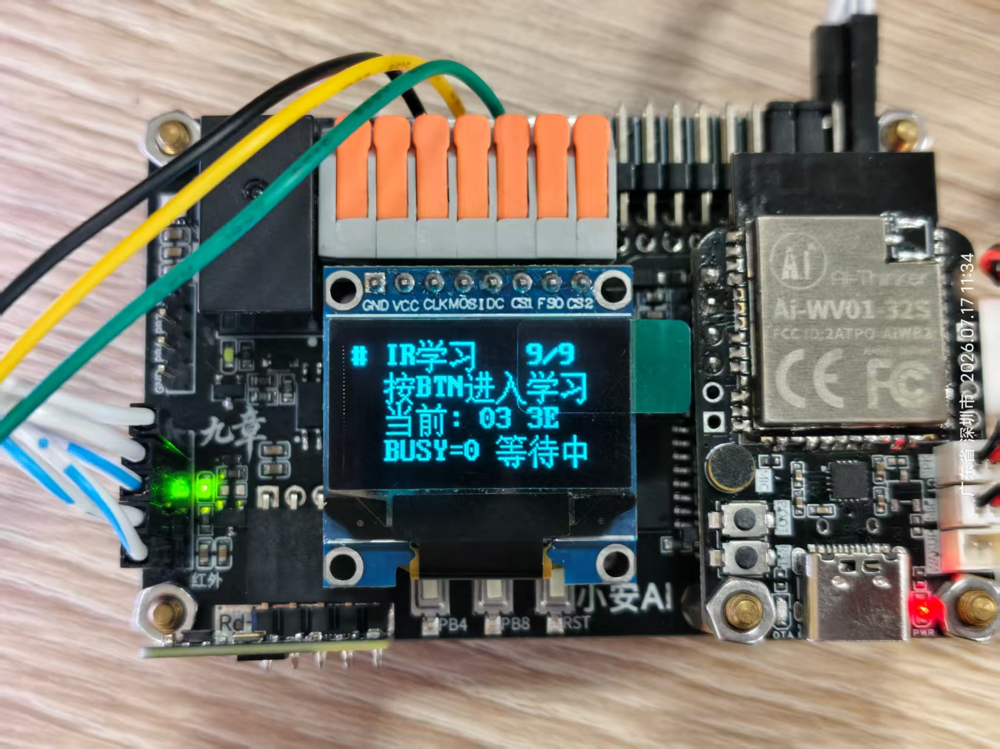</td>
</tr>
</table>

---
## 📸 MCP 交互流程

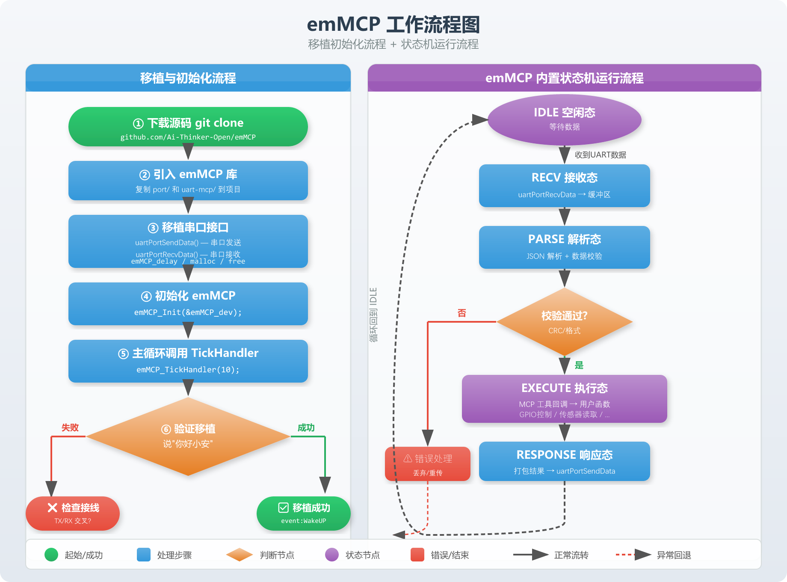

---
## 🤖 MCP 工具

项目向 AI 模组注册了 **7 个 MCP 工具**：

| 工具 | 参数 | 功能 |
|------|------|------|
| `relay` | `state`: on/off | 继电器开关（空调总电源） |
| `temperature` | `value`: 16-31 | 红外设置空调温度 |
| `acmode` | `value`: auto/cool/dry/fan/heat | 红外切换运行模式 |
| `acpower` | `power`: on/off | 红外开关空调 |
| `acfan` | `speed`: auto/low/mid/high | 红外调节风速 |
| `ledstrip` | `mode`: on/off/set/query；`r`/`g`/`b`: 0-255；`brightness`: 0-100 | WS2812 灯带控制 |
| `serial_monitor` | `action`: open/close | 解析串口 STATUS 码驱动灯带 |

> 完整的 JSON Schema 定义见 `Core/Src/freertos.c` 中 `StartDefaultTask()` 的工具注册与 `mcp-tool` 发送部分。

### 对话示例

```
用户:   "把空调打开，调到 26 度制冷模式"
AI:     → acpower.set({power: "on"})
        → temperature.set({value: 26})
        → acmode.set({value: "cool"})
MCU:    → 红外发射: 开机 + 26°C + 制冷
        → OLED 更新显示

用户:   "把灯带调成暖黄色，亮度 50%"
AI:     → ledstrip.set({mode: "set", r: 255, g: 180, b: 50, brightness: 50})
MCU:    → WS2812 全灯变色

用户:   "我离开房间了"
AI:     → 不操作 (雷达自动关灯，无需 AI 干预)
MCU:    → Rd-03L 检测无人 → 5 秒后自动熄灯
```

---

## 📂 项目结构

```
XEMOWO_TEST20_MX/
├── Core/
│   ├── Inc/                        # 头文件 (HAL 配置、FreeRTOS 配置)
│   │   ├── main.h                  #   主程序头文件
│   │   ├── gpio.h / dma.h / spi.h  #   外设初始化声明
│   │   ├── tim.h / usart.h         #   定时器/串口声明
│   │   ├── FreeRTOSConfig.h        #   FreeRTOS 配置
│   │   └── stm32f1xx_hal_conf.h    #   HAL 模块裁剪
│   └── Src/                        # 源文件
│       ├── main.c                  #   入口: 时钟配置 + 外设初始化
│       ├── freertos.c              #   ★ 核心: 任务 + MCP 工具 + UI
│       ├── gpio.c / dma.c / spi.c  #   外设 HAL 初始化
│       ├── tim.c / usart.c         #   定时器/串口 HAL 初始化
│       ├── stm32f1xx_it.c          #   中断服务函数
│       └── stm32f1xx_hal_msp.c     #   HAL MSP 层
├── components/                     # ★ 外设驱动组件库
│   ├── SHT3x/                      #   SHT3x 温湿度传感器驱动
│   ├── SSD1306/                    #   SSD1306 OLED 显示驱动
│   │   └── gt20l16s/               #   GT20L16S 中文字库芯片驱动
│   ├── ws2812/                     #   WS2812B 灯带驱动 + 色彩数学库
│   ├── hxd039b2/                   #   HXD039B2 红外串口模块驱动
│   ├── radar/                      #   Rd-03L_V2 毫米波雷达驱动
│   ├── relay/                      #   继电器 GPIO 驱动
│   ├── log/                        #   彩色日志系统
│   ├── emMCP_config.h              #   emMCP 框架配置文件
│   ├── salary_cat_frames.h         #   猫咪像素动画数据 (28 帧)
│   └── CMakeLists.txt              #   组件库构建
├── Bsp/                            # 板级支持包
│   ├── spi/                        #   SPI 硬件驱动 (含 DMA)
│   ├── i2c/                        #   I²C 软件模拟驱动
│   ├── delay/                      #   微秒/毫秒延时
│   └── pwm_dma/                    #   WS2812 PWM+DMA 底层驱动
├── Drivers/                        # STM32 官方驱动
│   ├── CMSIS/                      #   Core + Device (ST)
│   └── STM32F1xx_HAL_Driver/       #   HAL 库
├── Middlewares/                    # 第三方中间件
│   └── Third_Party/FreeRTOS/       #   FreeRTOS 内核
├── cmake/                          # CMake 构建配置
│   ├── gcc-arm-none-eabi.cmake     #   ARM GCC 工具链
│   ├── starm-clang.cmake           #   ST ARM Clang 工具链
│   └── stm32cubemx/                #   CubeMX 生成代码的 CMake
├── 9Mod_MCPBorad.ioc               # STM32CubeMX 项目文件
├── CMakeLists.txt                  # 顶层 CMake 构建
├── CMakePresets.json               # CMake 预设 (Debug/Release)
├── STM32F103XX_FLASH.ld            # 链接脚本
├── openocd.cfg                     # OpenOCD 调试配置
└── README.md                       # 本文件
```

---

## 🚀 快速开始

### 前置要求

| 工具 | 版本 | 说明 |
|------|------|------|
| **ARM GNU GCC** | 10.3+ | `arm-none-eabi-gcc` 交叉编译器 |
| **CMake** | 3.22+ | 构建系统 |
| **Ninja** | 1.10+ | 快速构建工具 |
| **STM32CubeMX** | 6.x | (可选) .ioc 配置文件修改 |
| **OpenOCD** | 0.12+ | (可选) 烧录调试 |
| **ST-Link** | V2 | 调试器硬件 |

### 编译

```bash
# 1. 克隆仓库 (如果还没有)
git clone https://github.com/Ai-Thinker-Open/emMCP.git
cd emMCP/example/XEMOWO_TEST20_MX

# 2. CMake 配置 (Debug)
cmake --preset Debug

# 3. 编译
cmake --build build/Debug

# 输出文件:
#   build/Debug/XEMOWO_TEST20.bin   ← 烧录文件
#   build/Debug/XEMOWO_TEST20.hex   ← 备用格式
#   build/Debug/XEMOWO_TEST20.elf   ← 调试文件
```

### 烧录

```bash
# 使用 OpenOCD + ST-Link
openocd -f openocd.cfg -c "program build/Debug/XEMOWO_TEST20.bin 0x08000000 verify reset exit"
```

### 调试

```bash
# 启动 OpenOCD 服务
openocd -f openocd.cfg

# 另开终端，GDB 连接
arm-none-eabi-gdb build/Debug/XEMOWO_TEST20.elf \
  -ex "target extended-remote :3333" \
  -ex "monitor reset halt" \
  -ex "load"
```

---


## 🙏 致谢

本项目基于以下开源项目构建：

| 项目 | 作者/组织 | 许可 | 说明 |
|------|----------|------|------|
| [emMCP](https://github.com/Ai-Thinker-Open/emMCP) | 安信可科技 (Ai-Thinker) | MIT | 嵌入式 MCP 框架 |
| [STM32CubeMX](https://www.st.com/stm32cubemx) | STMicroelectronics | — | HAL 代码生成 |
| [FreeRTOS](https://www.freertos.org/) | Amazon Web Services | MIT | 实时操作系统 |
| [CMSIS](https://www.keil.com/pack/doc/CMSIS/) | ARM Limited | Apache 2.0 | Cortex-M 软件接口 |
| [cJSON](https://github.com/DaveGamble/cJSON) | Dave Gamble | MIT | 轻量 JSON 解析库 |

### 特别感谢

- 🐱 猫咪像素动画素材来源于网络，仅供学习参考
- 🤖 AI 模组由 **安信可 AiPi-PalChatV1** 提供 MCP 通信能力
- 🔧 本项目作者：[XEMOWO](https://github.com/XEMOWO)

---

<div align="center">
  <br>
  <sub>Made with ❤️ by XEMOWO | Powered by STM32 + emMCP + FreeRTOS</sub>
  <br><br>
  <a href="https://github.com/Ai-Thinker-Open/emMCP">⭐ Star emMCP on GitHub</a>
</div>
